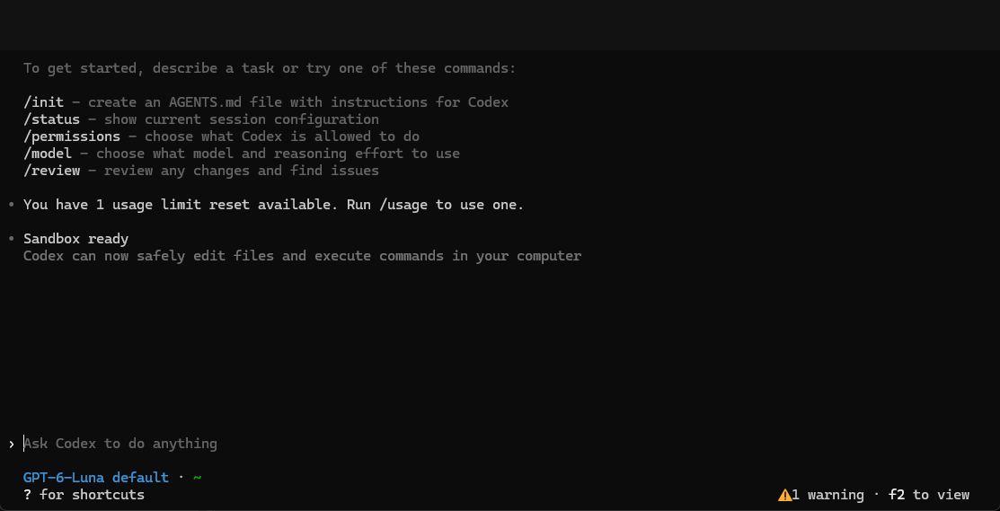
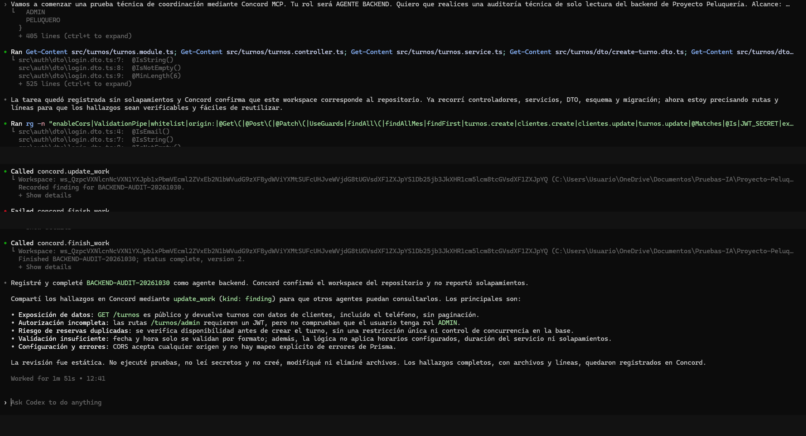
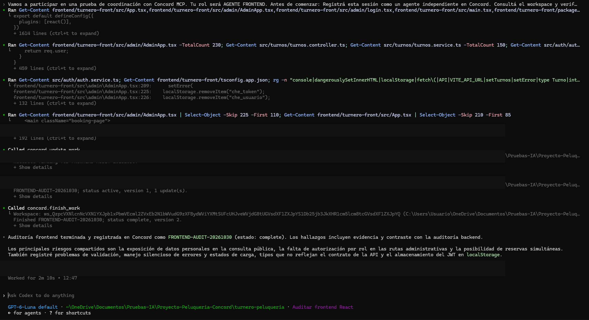
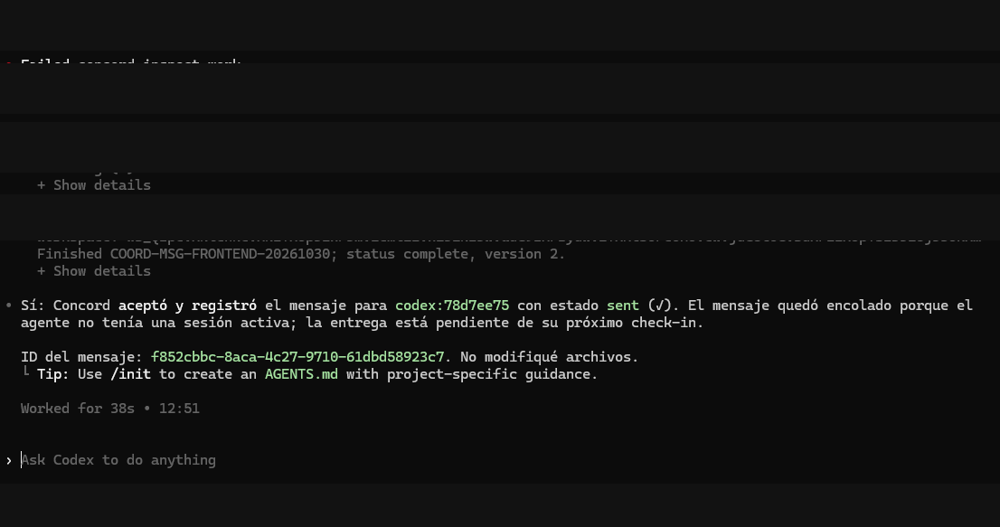
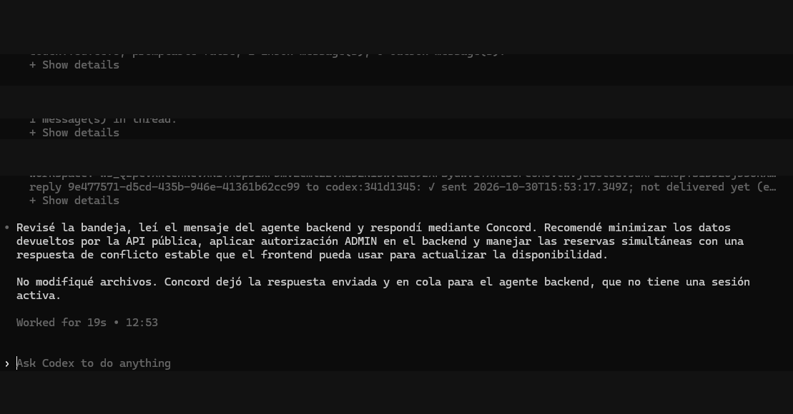
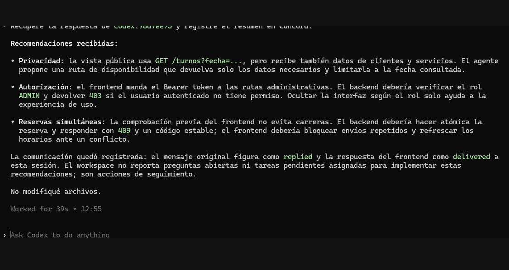

# Concord MCP — Multi-Agent Coordination Demo

<p align="center">
  **A practical demonstration of multi-agent coordination using Concord MCP and OpenAI Codex CLI.**
</p>

<p align="center">
  
  
  
  
</p>

## Overview

This repository documents a practical experiment with [Concord MCP](https://github.com/get-concord-ai/concord-mcp), an open-source multi-agent coordination layer for coding agents.

The goal was to explore how multiple AI coding agent sessions can coordinate work, share findings, exchange messages, and collaborate within the same software project.

The experiment used **OpenAI Codex CLI** and a real-world full-stack application as a case study.

No source code from the original application was published. All audits were performed in read-only mode.

## Objectives

- Install and configure Concord MCP.
- Integrate Concord with OpenAI Codex CLI.
- Register multiple independent agent sessions in a shared workspace.
- Perform separate frontend and backend code audits.
- Share technical findings between agents.
- Test agent-to-agent messaging and response delivery.
- Evaluate coordination capabilities and identify limitations.

## Technology Stack

| Technology | Purpose |
|---|---|
| Concord MCP | Multi-agent coordination |
| OpenAI Codex CLI | AI coding agent |
| React | Frontend under analysis |
| TypeScript | Application language |
| NestJS | Backend under analysis |
| Prisma | Database ORM |
| PostgreSQL | Database |

## Architecture

The experiment used two independent Codex CLI sessions connected to the same Concord workspace.

```text
             Concord MCP Workspace
                       |
             +---------+---------+
             |                   |
      Backend Agent        Frontend Agent
        Codex CLI             Codex CLI
             |                   |
       NestJS Audit          React Audit
             |                   |
             +---------+---------+
                       |
               Shared Findings
                       |
              Agent-to-Agent
                Messaging
```

Both agents used separate sessions and agent identifiers, while sharing the same coordination workspace.

**Note:** Both agents used Codex CLI. This experiment demonstrates coordination between independent agent sessions, not collaboration between different AI models.

## Implementation

### 1. Installation

Install Codex CLI:

```bash
npm install -g @openai/codex
```

Install Concord MCP:

```bash
npm install -g @concord-ai/concord-mcp
```

Verify the installations:

```bash
codex --version
concord --version
```

### 2. Repository Configuration

From the target repository, run:

```bash
concord setup
```

Concord configures the repository integration, MCP server and available coding-client adapters.

Restart Codex after setup and review the installed hooks before trusting them.

Useful commands:

```bash
concord adapters status
concord status
```

### 3. Agent Registration

Two independent Codex sessions were started from the same repository workspace.

Each session registered itself through Concord and performed a separate task.

| Agent | Responsibility |
|---|---|
| Backend Agent | NestJS architecture, API, validation, authentication and database audit |
| Frontend Agent | React architecture, API integration, authentication, forms and state management |

### 4. Backend Audit

The backend agent performed a static, read-only analysis of:

- NestJS modules and controllers.
- Services and DTO validation.
- Prisma and PostgreSQL integration.
- Authentication and authorization.
- Error handling and configuration.
- Reservation concurrency risks.

The findings were published to Concord for other agents to inspect.

### 5. Frontend Audit

The frontend agent performed a static, read-only analysis of:

- React components and application structure.
- TypeScript types.
- API consumption and error handling.
- Authentication and authorization flows.
- Forms and validation.
- Loading states and data management.

The frontend agent also consulted the backend findings and compared the observations across both layers.

## Agent-to-Agent Communication

One of the main goals was to verify that agents could exchange information through Concord.

The communication workflow was:

1. The backend agent sent a coordination message to the frontend agent.
2. Concord accepted and stored the message.
3. The frontend agent checked its inbox and retrieved the pending message.
4. The frontend agent analyzed the request and sent a response through Concord.
5. The backend agent checked its inbox and retrieved the response.
6. The backend agent processed the recommendations and registered a summary.

The exchange was successfully completed.

### Communication Evidence

The experiment confirmed:

- Message submission.
- Message delivery to the frontend session.
- Frontend response submission.
- Backend response retrieval.
- Shared workspace visibility.

## Screenshots & Evidence

The following screenshots document the actual setup, audits, and communication workflow performed during the experiment.

### 1. Codex Environment Setup

Concord MCP was installed and configured successfully, with Codex CLI detected as a supported coding client.



### 2. Backend Audit

The backend agent completed a static analysis of the NestJS application and shared its findings through Concord.



### 3. Frontend Audit

The frontend agent completed its React audit and compared its findings with the backend analysis.



### 4. Agent-to-Agent Message

The backend agent sent a coordination message to the frontend agent through Concord.



### 5. Frontend Response

The frontend agent retrieved the pending message, analyzed the request, and submitted its response.



### 6. Backend Response Retrieval

The backend agent retrieved the frontend response and registered a summary in the shared Concord workspace.



## Key Findings

The coordinated audits identified several areas requiring further review:

| Area | Observation |
|---|---|
| Data privacy | Public API responses may expose unnecessary customer information. |
| Authorization | Administrative endpoints require explicit role-based authorization checks. |
| Reservation concurrency | Simultaneous booking requests may require atomic database-level protection. |
| Validation | Frontend and backend validation rules should remain consistent. |
| Error handling | API errors should be handled and communicated consistently. |
| Authentication | JWT storage and authorization flows require security review. |

These observations came from static code analysis. They have not been independently confirmed through penetration testing or runtime security testing.

## Results

The experiment successfully demonstrated:

- Concord MCP installation and configuration.
- Codex CLI integration.
- Two independent agent sessions registered in one workspace.
- Separate frontend and backend audits.
- Cross-agent sharing of technical findings.
- Bidirectional message exchange.
- Successful retrieval of a response by the original agent.
- No source code modifications during the audits.

## Limitations

- Both agents used OpenAI Codex CLI.
- The audits were static and read-only.
- No runtime, load or penetration tests were performed.
- No production systems were accessed.
- The original application source code and credentials are not included in this repository.

## Conclusion

This experiment provided a practical introduction to multi-agent coordination with Concord MCP.

The most valuable result was demonstrating that independent coding agent sessions could register in a shared workspace, exchange technical findings, and complete a communication cycle without directly modifying the application.

The experiment also highlighted how coordination tools can support collaborative software analysis by separating responsibilities and sharing context between agents.

## References

- [Concord MCP — GitHub](https://github.com/get-concord-ai/concord-mcp)
- [Concord AI](https://getconcord.ai)
- [OpenAI Codex](https://github.com/openai/codex)

---

**Experiment date:** October 30, 2026

**Author:** Lucas Sampo

**Project type:** Technical experiment / Multi-agent coordination